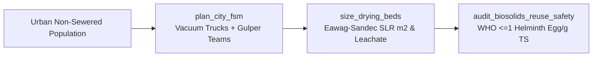

# fsm-plan

[](https://github.com/codesphere-u/fsm-plan/actions/workflows/ci.yml)
[](LICENSE)
[](pyproject.toml)
[](pyproject.toml)

**Zero-dependency Eawag-Sandec Fecal Sludge Management (FSM) engineering kit: pit-latrine fill-rate & emptying intervals, vacuum-truck/Gulper fleet sizing, sludge drying beds, and WHO helminth pathogen inactivation.**

- **Mission Domain:** Urban Sanitation, WASH & Public Health Engineering
- **Stack:** Pure Python 3.11+ (zero runtime third-party dependencies, `mypy --strict`, `ruff`, `pytest`)
- **Maintainer:** Codesphere Innovations (U) Limited (`codesphere-u`)

---

## Problem Solved

Over 80% of urban Sub-Saharan Africa relies on non-sewered pit latrines and septic tanks, yet municipal planners lack lightweight offline tools to size vacuum-truck vs. Gulper fleets, FSTP drying beds, and WHO helminth reuse safety.

## Key Features

- Household and communal containment fill-rate estimator (`estimate_pit_fill_years`) accounting for pit type and municipal trash ingress.
- City-wide FSM fleet & treatment planner (`plan_city_fsm`, `size_drying_beds`) splitting demand between vacuum trucks and narrow-alley Gulper teams while sizing Eawag-Sandec Solids Loading Rate drying beds.
- WHO (2006) biosolids reuse pathogen safety auditor (`audit_biosolids_reuse_safety`) enforcing `<= 1` viable helminth egg/g TS via ambient desiccation time or `>=55C` thermophilic co-composting.

## Architecture Overview



See [docs/architecture.md](docs/architecture.md) for module-level design details.

## Installation

```bash
git clone https://github.com/codesphere-u/fsm-plan.git
cd fsm-plan
uv sync --extra dev
```

Or install in editable mode with standard `pip`:

```bash
pip install -e ".[dev]"
```

## Quick Start (CLI)

```bash
fsm-plan --city MBARARA-CITY --population 220000 --inaccessible-pct 35 --composted
```

## Quick Start (Python API)

```python
from fsm_plan import CitySanitationSpec, audit_biosolids_reuse_safety, plan_city_fsm

plan = plan_city_fsm(CitySanitationSpec('GULU', non_sewered_population=180000))
assert plan.vacuum_trucks_required >= 1 and plan.drying_beds.net_drying_bed_area_m2 > 1000
assert audit_biosolids_reuse_safety(thermophilic_composted=True).safe_for_unrestricted_agriculture
```

## Testing & Quality Gates

```bash
uv run ruff check src tests
uv run mypy src
uv run pytest -v
```

## Security, Contributing & Roadmap

- **Security:** See [SECURITY.md](SECURITY.md) for responsible disclosure procedures.
- **Contributing:** See [CONTRIBUTING.md](CONTRIBUTING.md) and [CODE_OF_CONDUCT.md](CODE_OF_CONDUCT.md).
- **Changelog & Roadmap:** See [CHANGELOG.md](CHANGELOG.md) and [ROADMAP.md](ROADMAP.md).

## License

MIT License — see [LICENSE](LICENSE).

## Support & Contact

Open an issue on [GitHub Issues](https://github.com/codesphere-u/fsm-plan/issues) or contact `codesphereinnovationz@gmail.com`.
